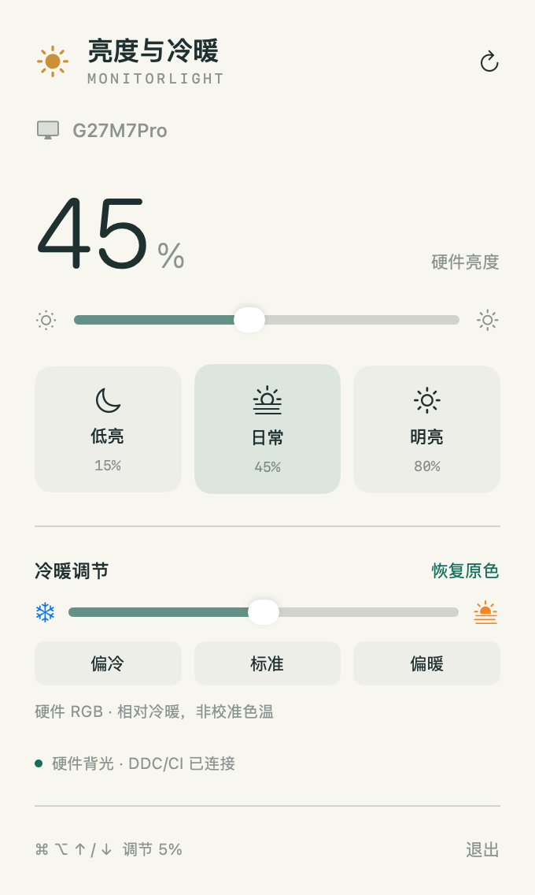

# MonitorLight · 外接显示器亮度与冷暖控制

为 Apple Silicon Mac 制作的轻量菜单栏应用，通过 **DDC/CI 调节外接显示器的真实硬件背光**。点击菜单栏太阳图标即可调亮度，省去伸手按显示器实体按键。



## 功能

- 自动检测外接显示器，多台时可切换目标；启动、显示器配置变化及电脑唤醒后重新检测。
- 亮度滑块，以及低亮 15%、日常 45%、明亮 80% 三个预设。
- 1.1 新增硬件冷暖滑块、偏冷／标准／偏暖预设和“恢复原色”。首次主动调色前按显示器保存原始 RGB，重启后仍可恢复。
- 冷暖通过相对 RGB 增益实现，不是精确的 Kelvin 校准；“标准”指首次调色前原色，不保证 6500K。没有软件滤镜替代模式。
- RGB 读取失败时停用冷暖控件；写入失败会尽力回滚并报告恢复结果，不影响亮度功能。
- `⌘⌥↑` 加亮 5%，`⌘⌥↓` 减亮 5%；快捷键注册失败时仍可使用滑块。
- 每次硬件写入后读回校验，失败时显示原因。
- 不占用 Dock，不需要账号，不自动加入登录项。
- 首次启动只读取当前亮度，不自动改变或套用历史亮度。

## 下载与安装

仓库内的 [MonitorLight-macOS-arm64.zip](downloads/MonitorLight-macOS-arm64.zip) 为 1.1.0，适用于 Apple Silicon Mac。更新时先退出旧版，再替换应用。

1. 点击 ZIP 文件，然后选择 **Download raw file** 下载。
2. 解压，将 `MonitorLight.app` 拖入“应用程序”。
3. 打开应用，点击顶部菜单栏的太阳图标。
4. 拖动滑块或使用预设；面板底部可以退出。

应用使用本机 ad-hoc 签名，**尚未获得 Apple Developer ID 签名或 Apple 公证**。在其他电脑首次启动时，macOS 可能阻止打开；请核对来源，或从源码自行构建。不要关闭系统整体安全保护。

## 兼容范围

“能检测到”和“能调亮度”是两件事。

| 情况 | 当前支持情况 |
| --- | --- |
| Apple Silicon Mac + 支持 DDC/CI 的外接显示器 | 目标支持，实际效果需结合型号、固件和连接方式验证 |
| 多台外接显示器 | 已实现列表检测和切换；目前仅实测一台外接屏 |
| 笔记本内置屏幕 | 主动排除，仍使用 macOS 自带亮度控制 |
| Intel Mac | 当前不支持内置 m1ddc 硬件控制层 |
| M1 内置 HDMI 等部分通道 | 开源通信层存在限制，可尝试 USB-C / DisplayPort 通道 |
| 不传递 DDC 的扩展坞、虚拟屏或不支持 DDC/CI 的显示器 | 无法保证识别或调节；当前没有软件压暗替代模式 |

**不承诺适配所有型号。** 已验证组合：MacBook Pro / M1 Pro + HKC G27M7Pro，系统报告为 DisplayPort 通道、4K 144Hz。

- 直接硬件探测：原值 0 → 写入 3 → 读回 3 → 恢复 0。
- 应用自测：预设 15 → 加亮 20 → 减亮 15 → 恢复 0。

百分比是显示器控制档位，不是尼特数。HDR、分区背光、显示器预设和固件可能限制亮度调节。测试边界见 [VERIFICATION.md](VERIFICATION.md)。

**冷暖实测边界：** HKC G27M7Pro 当前图像模式可读 RGB `[44, 44, 50]`，但小幅暖色写入未通过读回验证，已确认恢复原值。因此新版包含冷暖功能，但不能声称在该模式下成功调色。可以手动检查显示器是否有用户／自定义色温模式，以及 HDR 是否锁定 RGB；应用不会自动切换模式。其他型号须各自验证，不能因能调亮度就认定能调冷暖。

## 常见问题

**没有检测到显示器，或调节报错？**

确认显示器菜单中的 DDC/CI 已开启（如果有该选项），检查线缆与扩展坞是否传递 DDC，尝试 USB-C / DisplayPort 直连，再点击面板右上角重新检测。HDR 模式可能不接受普通亮度命令。

**为什么没显示 MacBook 内屏？**

当前只管理外接屏，内屏由系统控制。检测到多个可枚举外接屏时，面板才显示选择器。

**“恢复原色”恢复什么？**

恢复该显示器第一次通过本应用主动调色前保存的 RGB，不是出厂复位。启动、切换屏幕及唤醒只读取，不自动应用颜色。手动更改显示器图像模式可能使基线不再适合；如果通道范围变化或本地原色记录损坏，应用会停用调色，防止覆盖记录。

**快捷键不起作用？**

先用滑块确认硬件控制正常，再检查 `⌘⌥↑ / ↓` 是否被其他应用占用。两个快捷键已完成注册测试，物理键盘触发尚未独立验证。

## 从源码构建

需要 Apple Silicon Mac、macOS 13+，以及支持 Swift 5.9+ 的 Apple Command Line Tools / Xcode。发行构建目前只在开发机器验证，旧系统兼容性尚未逐一测试。

```sh
git clone https://github.com/zhuolin272-dotcom/MonitorLight.git
cd MonitorLight
bash build.sh
```

默认产物为 `dist/MonitorLight.app` 和 `dist/MonitorLight.zip`。

构建脚本先运行核心测试，再编译 Swift 应用和固定版本 m1ddc，在临时目录签名并验证，最后生成不含 Finder 扩展属性的 ZIP。设置 `MONITORLIGHT_OUTPUT_DIR` 可自定义输出目录，设置 `MONITORLIGHT_BUILD_DIR` 可复用编译缓存。

只运行测试：

```sh
swift test --build-system native
```

较新 Swift 版本可能提示 `native` 构建系统已弃用；当前验证环境仍支持它。

## 实现结构

```text
Sources/BrightnessCore/      显示器解析、范围检查与百分比换算
Sources/MonitorLight/        菜单栏、SwiftUI 面板、串行 DDC 通信和快捷键
Tests/BrightnessCoreTests/   核心逻辑测试
Resources/                  应用元数据和图标生成脚本
Vendor/m1ddc/               固定版本的上游源码及许可证
downloads/                  最新 arm64 应用压缩包
```

通信命令始终指定目标显示器 UUID，避免误调默认显示器。每条命令 5 秒超时，滑块写入有 220ms 防抖；不会自动调节内屏。

## 隐私与权限

- 应用运行时没有网络请求、账号、数据上传或遥测。
- 只在本机保存所选显示器 UUID，以及按 UUID 区分的原始 RGB 颜色；不上传这些记录。
- 当前快捷键使用 Carbon 注册，应用本身不要求辅助功能或管理员权限。

## 第三方组件与许可

硬件通信基于 [waydabber/m1ddc](https://github.com/waydabber/m1ddc)，固定提交 `04d949794102eb8df01ad3681afff6464a3eede2`，使用 MIT License。上游版权和许可证包含于 `Vendor/m1ddc/LICENSE`，并随应用分发。

MonitorLight 自身代码暂未指定开源许可证；上传仓库不自动授予再分发许可。第三方组件许可独立适用。详见 [THIRD_PARTY_NOTICES.md](THIRD_PARTY_NOTICES.md)。
